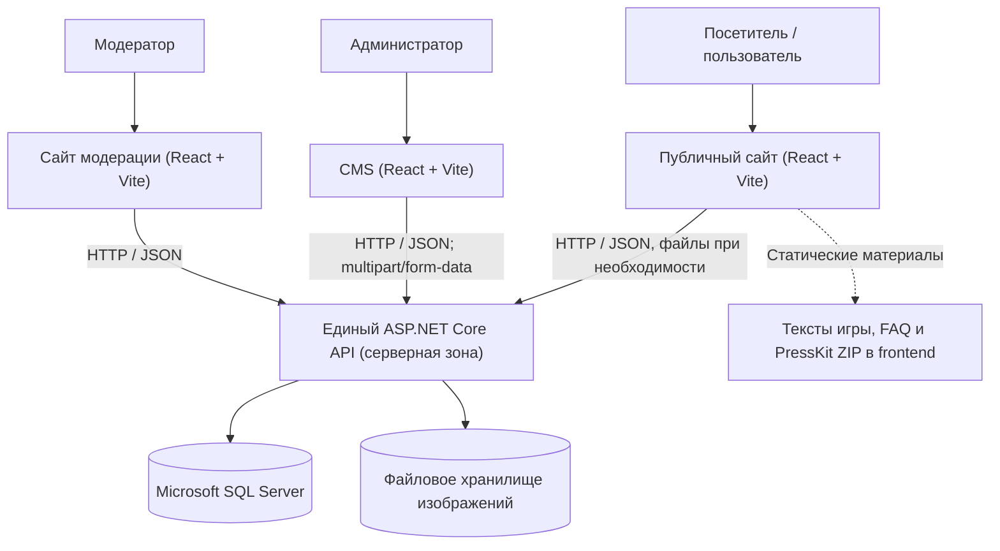
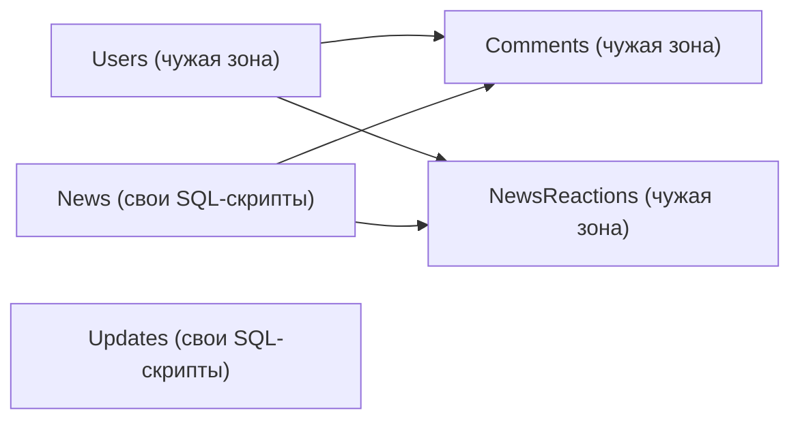

# Архитектура вебсайта «ЗАРЯ»

> **Статус:** создан frontend-каркас и первый участок новостей с MSW.
> Реализованы три независимых приложения React/JSX/Vite, npm workspaces, ESLint, CheckJS, Vitest/React Testing Library и конфигурация Playwright. Функции и контракты ниже остаются целевыми, если явно не указано иное.
> При обнаружении существующей структуры проекта её необходимо изучить и согласовать изменения, а не автоматически перестраивать.

## 1. Назначение и основания

**«ЗАРЯ»** - официальный имиджевый и коммуникационный вебсайт игры **«ЗАРЯ: Марш Революции»**. Он предназначен для представления игры, публикации новостей и обновлений, общения с пользователями и предоставления материалов для прессы.

Основания:

1. `КроленкоИВ_Задание_ВебсайтЗАРЯ.pdf` - индивидуальное задание на учебную практику (в особенности пункты 6.3-6.5 и приложение).
2. `АТиИСРПО_Практическая1_КроленкоИВ (1).pdf` - техническое задание с углублением в frontend (в особенности разделы 2-3, 7 и приложение А).
3. Решения, согласованные для данного проекта: один репозиторий; JavaScript + React + Vite с проверкой JSDoc/CheckJS; **полное исключение подписок и рассылок**; запрет на изменение серверного кода; отдельные SQL-скрипты `News` и `Updates`.

При расхождении документов с согласованными изменениями объёма работ применяются эти изменения. Остальные требования исходных документов сохраняются. Отступления от официального учебного задания при необходимости отдельно согласуются с руководителем практики.

## 2. Границы системы и ответственность

### 2.1. Состав системы

| Подсистема | Технологии | Назначение | Право изменения в рамках данной работы |
| --- | --- | --- | --- |
| Публичный сайт | React, JavaScript, Vite | Страницы игры, новости, обновления, регистрация, профиль, комментарии, реакции, PressKit | **Да** |
| CMS | Отдельное React-приложение | Управление новостями, обновлениями и изображениями | **Да** |
| Сайт модерации | Отдельное React-приложение | Просмотр и удаление комментариев после подтверждения | **Да** |
| Скрипты `News` и `Updates` | T-SQL, Microsoft SQL Server | Проектирование и создание двух закреплённых таблиц | **Да**, только собственные SQL-скрипты и после согласования схемы |
| Backend API | ASP.NET Core, Entity Framework Core | Аутентификация, права доступа, валидация, бизнес-логика, операции с данными и файлами | **Нет: только чтение** |
| Другие таблицы | Microsoft SQL Server | `Users`, `Comments`, `NewsReactions` и связанные данные | **Нет: только чтение схем/контрактов** |
| Серверные миграции и настройки | EF Core, конфигурация сервера | Эволюция серверной схемы и инфраструктуры | **Нет** |

**Абсолютная граница:** агент и исполнитель не правят backend, его конфигурацию, серверные миграции, серверные проекты и чужие таблицы. Если требуется изменение API или серверной модели, задача оформляется как запрос ответственному разработчику; обходные серверные правки запрещены.

### 2.2. Исключённый функционал

**Подписки, рассылки и почтовый сервис полностью исключены из текущего объёма.** Не реализуются:

- форма подписки на главной странице;
- переключатель подписки при регистрации;
- учёт и хранение подписчиков;
- флаг «Оповестить» в CMS;
- отправка писем и ссылки отписки;
- связанная логика API на стороне frontend.

Поле **электронной почты как идентификатор учётной записи** сохраняется в регистрации, входе и профиле. Подтверждение почты письмом не требуется.

## 3. Общая схема



Важные инварианты:

- Браузер общается с данными **только через API**, без прямого подключения к SQL Server.
- Все три приложения независимы по интерфейсу и сборке, но используют один серверный API.
- Проверка ролей в браузере улучшает интерфейс, но **не заменяет** серверную авторизацию.
- Вся запись в БД из приложений выполняется через API. SQL-скрипты применяются отдельно, с согласованием с разработчиком backend.
- Текстовое описание игры, FAQ, ссылки на соцсети и текст PressKit входят в сборку публичного frontend, а не загружаются из API.

## 4. Структура репозитория

**Целевая** структура. В каркасе созданы `Frontend/apps/web`, `Frontend/apps/cms`, `Frontend/apps/moderation`; в каждом приложении есть `src/app`, `src/pages`, `src/styles`, `src/test`. Остальные показанные каталоги создаются только при появлении соответствующего кода. Backend и SQL пока отсутствуют.

```text
zarya-website/
├── README.md                   # краткое описание проекта
├── Frontend/
│   ├── README_Frontend.md
│   ├── ARCHITECTURE_Frontend.md
│   ├── AGENTS_Frontend.md
│   ├── package.json            # npm workspaces, команды из Frontend
│   ├── package-lock.json
│   ├── eslint.config.js
│   ├── playwright.config.js
│   ├── .nvmrc
│   ├── .gitignore
│   ├── apps/
│   │   ├── web/
│   │   ├── cms/
│   │   └── moderation/
│   │       # каждое приложение: src/app, pages, styles, test;
│   │       # main.jsx, index.html, package.json, jsconfig.json, vite.config.js
│   ├── tests/e2e/
│   └── database/news-updates/  # планируется после согласования SQL
└── Backend/                   # зона другого разработчика, только чтение
    └── .gitkeep               # сохраняет пока пустой каталог в Git
```

Структура внутри `src` - ориентир, а не требование создавать пустые каталоги заранее. Не вводить `packages/shared`, UI-kit, монорепо-фреймворки и лишние уровни абстракции до появления реального повторного кода и согласования. Три React-приложения можно вести через обычные **npm workspaces**.

## 5. Выбранный frontend-стек

| Инструмент | Решение |
| --- | --- |
| React | Компоненты и состояние интерфейса |
| JavaScript + JSX | Основной язык всех трёх приложений; не требуется переводить проект на `.ts/.tsx` |
| Vite | Локальная разработка и независимая сборка приложений |
| JSDoc + TypeScript `checkJs` | Статическая проверка типов в `.js/.jsx` без генерации TypeScript-кода |
| ESLint | Анализ потенциальных ошибок и правил React |
| Vitest | Быстрые тесты функций, компонентов и прикладной логики |
| React Testing Library | Проверка поведения и содержимого компонентов с точки зрения пользователя |
| Playwright | Отдельные браузерные, адаптивные и при необходимости визуальные проверки |

Возможная конфигурация проверки JavaScript в каждом frontend-приложении:

```json
{
  "compilerOptions": {
    "allowJs": true,
    "checkJs": true,
    "noEmit": true,
    "jsx": "react-jsx"
  },
  "include": ["src"]
}
```

Это **образец**, а не готовая конфигурация: при создании проекта уточняются модульное разрешение, библиотеки DOM, типы React и тестового окружения. Для сложных структур данных использовать JSDoc, особенно на границе API. В отдельных случаях допустимы точечные отключения проверки с объяснением причины; не отключать `checkJs` глобально ради устранения ошибок.

## 6. Публичное приложение

### 6.1. Страницы

| Экран | Функции |
| --- | --- |
| Главная | Название и краткое описание игры; раскрытие полного описания без запроса к API и смены маршрута; до 3 последних новостей и обновлений каждого типа; FAQ; ссылка на PressKit |
| Новости | Список опубликованных новостей с подгрузкой следующей страницы по кнопке «Показать ещё» |
| Новость | Обложка, заголовок, краткое и полное описания, дата/время публикации, число положительных и отрицательных реакций, управление реакцией и комментарии с именем/аватаром автора и датой |
| Обновления | Список опубликованных обновлений с подгрузкой следующей страницы |
| Обновление | Версия, заголовок, дата выхода, секции «Новое», «Изменено», «Исправлено» только при наличии содержимого |
| PressKit | Логотип, описание, жанр, статус/дата релиза, платформы, изображения, трейлер при наличии, контакты и соцсети, статический ZIP для скачивания |
| Регистрация | Email, пароль, подтверждение, имя, предустановленный аватар (необязателен); **без подписки** |
| Вход | Email **или** имя пользователя и пароль |
| Профиль | Просмотр и изменение имени, email, пароля, аватара |

Конкретные URL-пути (например, `/news/:id`) уточняются при проектировании маршрутизации. Формат идентификатора (`id` или `slug`) нельзя считать согласованным до проверки API.

### 6.2. Навигация и адаптивность

- При ширине **1024 px и более** верхняя навигация содержит логотип, название игры, «Главная», «Новости», «Обновления», «PressKit», управление входом/профилем и ссылки на социальные сети.
- При ширине **менее 1024 px** основные навигационные ссылки открываются через кнопку меню.
- Сетки карточек новостей и обновлений: **4 в строке при ширине от 1440 px**, **3 при 768-1439 px**, **1 при ширине менее 768 px**.
- Поддерживаемая ширина публичного сайта - **от 320 px**.
- Контент главной: максимум **три опубликованные** новости и **три опубликованных** обновления, сортировка по времени публикации по убыванию.
- Карточка новости: обложка, заголовок, краткое описание, дата публикации; карточка обновления: версия, название и дата выхода.
- «Показать ещё» запрашивает следующую страницу и исчезает, когда следующей страницы нет. Схема пагинации согласуется с API.

### 6.3. Пользовательские действия

- Регистрация: локальная проверка полей, запрос к API; при успехе сообщение о создании учётной записи и переход ко входу.
- Вход: сервер устанавливает cookie; при последующих запросах клиент корректно использует cookie в соответствии с договорённостями по origin/CORS и защитой от CSRF. После выхода переход на главную.
- Комментарии: без сессии текст **«Для добавления комментария выполните вход»**; с сессией форма добавления. Пользователь может удалить только **собственный** комментарий.
- Реакции доступны **только для новостей**. Положительная и отрицательная реакции взаимно исключают друг друга; повторный выбор снимает реакцию.
- Профиль: изменение данных отправляется на сервер после успешной проверки соответствующих полей.

## 7. CMS и модерация

### 7.1. CMS

- Отдельное React-приложение с рабочей шириной **от 1024 px**.
- Доступ только после подтверждения роли **Admin** сервером. До ответа API защищённый интерфейс не отображается; при отказе выполняется перенаправление ко входу.
- Новости и обновления: создание, редактирование, удаление, сохранение без публикации, публикация.
- Время публикации определяется **backend**, не локальными часами браузера.
- Для изображений до отправки проверяются **JPEG, PNG, WebP** и размер **не более 5 МБ**. Передача - `multipart/form-data`.
- Флаг «Оповестить» **не реализуется**.

### 7.2. Сайт модерации

- Отдельное React-приложение с рабочей шириной **от 1024 px**.
- Доступ только после подтверждения роли **Moderator** сервером; защищённый интерфейс не показывается до проверки.
- Список комментариев: текст, имя автора, дата создания и ссылка на материал.
- Перед удалением требуется явное подтверждение.
- После успешного ответа API удалённый комментарий исчезает из списка. При ошибке не следует выдавать удаление за успешное.

Доступность CMS для Moderator и модерации для Admin **не предполагается автоматически**: конкретная матрица разрешений определяется контрактом backend и исходным ТЗ.

## 8. Данные и граница с API

### 8.1. Логическая модель (не окончательный SQL-контракт)



Связи выше обозначают предметную область, а не утверждённые внешние ключи. **Комментарии и реакции в явных требованиях связаны с новостями; распространение их на обновления отдельно не утверждено.** Окончательные связи, направления FK, имена столбцов и каскадные действия согласуются совместно с разработчиком backend.

| Сущность | Нужные в интерфейсе сведения | Ответственность |
| --- | --- | --- |
| `News` | Идентификатор, заголовок, краткое описание, полный текст, путь/URL обложки, черновик/публикация, дата/время публикации | Проектирование и T-SQL - здесь; API и серверные модели - у разработчика backend |
| `Updates` | Идентификатор, номер версии, название, дата выхода, записи разделов «Новое», «Изменено», «Исправлено», черновик/публикация | Проектирование и T-SQL - здесь; API и серверные модели - у разработчика backend |
| `Users` | Имя, email, аватар, роль, данные сессии | Backend |
| `Comments` | Автор, текст, дата, ссылка на материал | Backend |
| `NewsReactions` | Реакция конкретного пользователя на конкретную новость | Backend |

**SQL-решения пока не утверждены:** точные типы столбцов, размеры строк, PK/FK, индексы, модель хранения секций обновлений, представление статусов и даты, URL/пути изображений. Их нельзя изобретать как обязательный контракт. До создания DDL требуется сверка с существующим EF Core и владельцем серверных таблиц. Скрипты `News`/`Updates` создаются отдельно, **без изменения серверных миграций**. Применять их к общей БД только по согласованной процедуре, с сохранением данных и возможностью отката.

### 8.2. Контракт интеграции

| Вопрос | Требование / статус |
| --- | --- |
| Транспорт | HTTP(S) API; JSON для структурированных данных |
| Загрузка изображений | `multipart/form-data`, с клиентской и серверной валидацией |
| Аутентификация | Cookie устанавливается сервером; frontend передаёт её на допустимых запросах |
| Авторизация | Сервер подтверждает роль; frontend не заменяет контроль доступа |
| Ошибки | Клиент переводит ошибки API в безопасные сообщения и сохраняет данные форм |
| Пагинация | API должен позволять получать следующую страницу; поля запроса/ответа ещё согласуются |
| Публикация | Сервер выставляет дату/время; клиент передаёт содержимое и действие |
| URL, DTO, коды ответов | **Предварительный контракт новостей в 8.3**; остальные контракты не определены, нужна сверка с backend |
| Подписки/уведомления | **Вне объёма** |

В коде предусмотреть единый для **каждого приложения** слой запросов: базовый URL из окружения, обработка `credentials`, нормализация ошибок, адаптеры ответов. Не копировать предположения о полях API по всем React-компонентам. Нельзя хранить серверные секреты в переменных `VITE_*` (они попадают в клиентскую сборку).

При интеграции проверить междоменные cookie, CORS, CSRF, HTTP-статусы 401/403, согласованное представление дат и времени, размер файлов и формат валидационных ошибок. Серверные изменения по результатам проверки выполняет только его владелец.

### 8.3. Предварительный контракт списка новостей и MSW

**Предложение frontend, требует согласования с backend-разработчиком.** Не определяет SQL или EF Core. Реализован для независимой разработки интерфейса.

- GET /api/news?page=1&pageSize=12, Accept: application/json. Операция публичная, возвращает только опубликованные материалы.
- page: целое >=1, по умолчанию 1; pageSize: целое 1..50, по умолчанию 12.
- DTO карточки: id (непрозрачная строка), title, summary, coverUrl (строка URL или null), publishedAt (ISO 8601 UTC).
- Ответ 200: { items, page, pageSize, nextPage }. nextPage: номер следующей страницы или null. Пустая/вышедшая за пределы страница: items=[], nextPage=null. total не требуется.
- Сортировка: publishedAt по убыванию; при совпадении id по возрастанию. Постраничная выборка не гарантирует неизменность списка при конкурентных публикациях; клиент устраняет повторяющиеся id при добавлении страницы.
- Ответ 400: { code: 'INVALID_QUERY', message, errors: { page?: string[], pageSize?: string[] } }.
- Ответ 503: { code: 'SERVICE_UNAVAILABLE', message }. Сообщения API не выводятся напрямую; UI использует безопасный текст ошибки.
- JSDoc: Frontend/apps/web/src/api/news.contract.js. API-слой проверяет параметры и структуру ответа, поддерживает отмену через AbortSignal.
- VITE_API_BASE_URL включает API-префикс, по умолчанию /api/. Адреса и DTO остаются предварительными до сверки с backend.

Страница /news отделена от главной, которая пока содержит только ссылку. Список показывает загрузку, пустое состояние и ошибку с повтором; последующие ошибки сохраняют загруженные карточки. Кнопка блокируется во время запроса и скрывается при nextPage=null. Полная карточка материала и другие API-операции не реализованы.

**MSW:** центральные Frontend/mocks/news.js, scenarios.js, browser.js, server.js. Единственная новая прямая зависимость MSW 3.0.3; официальный msw/vite совместим с Vite 8.3.5. Плагин обслуживает worker только при разработке, без копии в public. Входная точка динамически подключает моки только при DEV и VITE_ENABLE_MOCKS=true и ожидает готовности до рендера. Обычный запуск не включает моки. Vitest явно запускает Node-интеграцию и сбрасывает обработчики между тестами.

Команда dev:web:mock включает сценарии default, empty, slow, error, network-error, next-page-error через VITE_MOCK_SCENARIO. Все данные вымышленные. Неизвестные HTTP-запросы выбранного API-origin и префикса запрещены; прочие ресурсы проходят. Авторизация, CMS, модерация и SQL этим этапом не затрагиваются. Производственная сборка проверяется на отсутствие worker, MSW-обработчиков и маркеров тестовых данных.

## 9. Валидация и обработка ошибок

| Поле / операция | Требование |
| --- | --- |
| Email | Формат `local-part@domain`; уникальность устанавливает API |
| Имя пользователя | 3-30 символов включительно; уникальность устанавливает API |
| Пароль | Минимум 8 символов; хотя бы одна буква и одна цифра |
| Подтверждение | Должно совпадать с паролем |
| Комментарий | После `trim()` от 1 до 1000 символов включительно |
| Загрузка в CMS | JPEG / PNG / WebP; размер не более 5 МБ |
| Ошибка поля | Сообщение под соответствующим полем |
| Сеть и HTTP 5xx | **«Не удалось выполнить операцию. Повторите попытку позже»** без технических деталей |
| Ошибка отправки формы | Введённые значения сохраняются до повторной отправки, закрытия или обновления страницы |

Клиент проверяет доступные правила **до запроса**, но окончательное решение всегда принимает API. UI не должен демонстрировать успешную операцию до подтверждения сервером.

## 10. Внешний вид и нефункциональные требования

- Публичный сайт: **тёмный фон, белый текст, контрастные заголовки, жёлто-оранжевые и фиолетовые акценты, графические мотивы карт и территориальных границ**.
- Поддержка двух последних стабильных версий **Chrome, Edge и Firefox** на дату приёмки.
- Основной заголовок страниц «Главная», «Новости», «Обновления», «PressKit» - в течение **3 с** с начала навигации при скорости загрузки >=20 Мбит/с, отдачи >=5 Мбит/с, задержке сети <=100 мс.
- Индикатор после действия, отправляющего API-запрос, - не позднее **200 мс**; результат после успешного ответа - не позднее **500 мс**.
- Системное расчётное требование: работа при **100-200 одновременных пользователях**; подтверждается интеграционными/нагрузочными проверками всей системы, а не одним frontend-тестом.
- Дополнительно рекомендуются семантическая HTML-разметка, управление с клавиатуры, подписи полей и базовая доступность. Это инженерные рекомендации, а не отдельные утверждённые критерии исходного ТЗ.

## 11. Стратегия тестирования

| Уровень | Инструменты | Проверки | Частота |
| --- | --- | --- | --- |
| Статический анализ | ESLint, CheckJS/JSDoc | Ошибки JS, недопустимые типы, правила React | После затронутых изменений |
| Быстрые тесты | Vitest | Валидация, преобразование DTO, логика пагинации, сортировка, переключение реакций | После затронутых изменений |
| Тесты UI | React Testing Library + Vitest | Формы, сообщения, состояния загрузки и ошибок, доступность кнопок | После затронутых изменений |
| Браузерные E2E | Playwright | Переходы между страницами, роли, сценарии с тестовым API, адаптивность | На контрольных этапах / по согласованию при тяжёлом запуске |
| Визуальные | Playwright screenshots | Регрессия оформления на эталонных ширинах | При необходимости, только в стабильном окружении |
| SQL | Отдельная тестовая база | Создание двух таблиц, ограничения, тестовые данные, интеграция с согласованным API | Перед передачей скриптов; только в разрешённой тестовой среде |

Минимальная матрица ширин: **1440, 1024, 768, 320 px**. Проверяются регистрация, вход/выход, профиль, списки и карточки, «Показать ещё», комментарии, реакции, CMS, загрузка изображений, модерация, защитные экраны, отсутствие сети и HTTP 503. Тест подписки и рассылки из приёмки исключён отдельным решением о сокращении функционала.

Не запускать длительные E2E, нагрузочные тесты, локальный сервер приложения или потенциально изменяющие общую БД проверки без согласования, если это не было прямо поручено. Если backend недоступен, можно тестировать frontend с предсказуемыми мок-ответами, **явно отмечая, что интеграция ещё не проверена**.

## 12. Последовательность реализации и открытые контракты

1. Сверить существующий репозиторий и зафиксировать неизменяемые пути backend.
2. Согласовать API для сессии/ролей, `News`, `Updates`, комментариев, реакций и загрузок; не угадывать endpoint и DTO.
3. Согласовать SQL-схемы `News` и `Updates` с владельцем EF Core и связанных таблиц; подготовить свои T-SQL-скрипты.
4. Создать три независимых приложения и базовые страницы/навигацию; добавить CheckJS, ESLint и быстрые тесты.
5. Реализовать публичный контент, профиль, новости/обновления, комментарии и реакции.
6. Реализовать CMS, сайт модерации, загрузку изображений и защиту интерфейсов по ролям.
7. Проверить интеграцию и критерии приёмки; провести браузерные проверки и исправить обнаруженные ошибки.

**Точки обязательного согласования:** формат API и механизм cookie/CSRF; DDL и связи таблиц; местоположение/формат статических материалов; существенные изменения структуры репозитория; любые изменения исходного функционального объёма.

В ходе практики также требуются проектные модели, диаграммы потоков данных и отчётные материалы, предусмотренные индивидуальным заданием. Этот `ARCHITECTURE_Frontend.md` помогает их подготовить, **но сам по себе не заменяет** все учебные диаграммы и отчётность.
