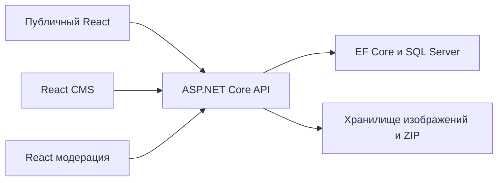

# Архитектура API

[Оглавление](../README.md) · [Безопасность](SECURITY.md) · [Примеры](EXAMPLES.md)

## Назначение и границы

Публичный сайт, CMS и модерация обращаются к одному ASP.NET Core API. Разделение приложений организует интерфейсы, но сервер заново проверяет сессию и права каждого запроса. EF Core и SQL Server остаются внутренней реализацией. Идентификаторы API являются непрозрачными строками, а не SQL или файловыми путями.

Это целевая схема. В текущем backend есть только каркас .NET 10. Три зоны стабильности описаны в [README](../README.md#три-зоны).

## HTTP и DTO

GET читает состояние. POST создаёт ресурс либо выполняет действие (publish, restore, recovery). PUT полностью заменяет представление: пропущенные поля черновика удаляются. PATCH меняет только описанные поля. DELETE удаляет ресурс либо его редакторскую часть. Корзина и окончательное удаление публикации различаются явно.

Обычные тела: `application/json`. Загрузка изображений: `multipart/form-data`. Список новостей: обязательный `multipart/mixed`. ZIP: `application/zip`.

`required` означает наличие поля, `nullable` допускает `null`. Отсутствие, `null` и пустая строка не взаимозаменяемы. Неполный черновик может не иметь обязательных при публикации полей. Превью Мировой Машины поэтому имеет собственный DTO. `additionalProperties: false` запрещает неизвестные поля; сервер должен реально отклонять массовое присваивание, а не только документировать это.

Даты событий: UTC RFC 3339 с `Z`. `releaseDate` имеет формат `YYYY-MM-DD` без часового пояса и не является временем публикации. `publishedAt` устанавливает сервер. Расписание проверяется относительно серверных часов. Проверка JSON Schema устанавливает синтаксис даты, но не проверяет, что она в будущем.

URL с `format: uri` абсолютные. Этот формат сам по себе допускает опасные схемы: для пользовательских ссылок нужна отдельная политика HTTP(S)/origin. HTML и произвольные URL не считаются безопасными после одной лишь проверки схемы.

## Ошибки

Общий `Error` содержит `code`, безопасный `message`, опциональные `errors` по именам полей и `requestId`. Stack trace, SQL и секреты не возвращаются. ASP.NET ProblemDetails нельзя молча подставлять вместо этого DTO: нужен адаптер.

| Статус | Значение и реакция клиента |
|---|---|
| 400 | Некорректный синтаксис или параметры |
| 401 | Сессия отсутствует или истекла |
| 403 | Нет прав/нужного состояния, отказ CSRF или Origin |
| 404 | Ресурс отсутствует либо скрыт, включая дочерние endpoints |
| 409 | Конфликт состояния, нет черновика, конфликт ключа идемпотентности |
| 410 | Recovery-токен использован или истёк |
| 412 | Версия устарела; перечитать ресурс и разрешить конфликт |
| 413 | Превышен размер загрузки |
| 422 | Поля или связи не проходят бизнес-валидацию |
| 428 | Не передан обязательный If-Match |
| 429 | Учитывать Retry-After, не повторять немедленно |
| 500/503 | Сохранить форму, показать безопасную ошибку; уточнить итог мутации |

Метод перечисляет применимые статусы. `204` и `304` не имеют тела. Текущий список новостей не поддерживает `304`: клиент ждёт полное multipart-тело. Ошибки, авторизация, CMS и персонализированные реакции используют `Cache-Control: no-store`.

## Пагинация

`page >= 1`, `1 <= pageSize <= 50`, по умолчанию 1 и 12. Ответ: `items`, `page`, `pageSize`, `nextPage`. Последняя и пустая страница возвращают `nextPage: null`. Для новостей следующая страница строго `page + 1`, id уникальны внутри страницы, элементов не больше pageSize.

Публичные новости сортируются по исходной `publishedAt DESC`, затем `id ASC`; сравнение строк нужно закрепить в backend, поскольку коллации SQL и .NET могут различаться. Для остальных списков нужен стабильный дополнительный ключ. Направление сортировки комментариев, CMS и административных списков ещё требует согласования. Изменения между страницами могут дать пропуски/повторы. Клиент новостей удаляет повторы, но не восстанавливает пропущенное. Cursor/snapshot требуют отдельного решения.

## Конкурентное редактирование

GET отдельного CMS-ресурса возвращает сильный `ETag` и `editVersion`. Клиент отправляет этот ETag в `If-Match`. Core сериализует версию как `"7"`; Extended возвращает непрозрачный сильный ETag. Новую версию нельзя вычислять на клиенте.

Сравнение и изменение выполняются в одной транзакции. В EF Core нужен concurrency token либо условный UPDATE с обработкой `DbUpdateConcurrencyException`. SELECT перед обычным UPDATE недостаточен. `412` означает, что текущая попытка изменения не выполнена. После успеха нужен новый ETag или повторный GET, если ответ без тела.

Коллекции и исторические редакции не выдают ETag текущего материала. Порядок FAQ использует `orderEditVersion` из `GET /api/cms/faq`, заключённый в кавычки для If-Match; версия вопроса независима. В пакете проверяется `expectedEditVersion` каждого элемента.

В этом профиле требуется один конкретный ETag: wildcard `*`, weak `W/` и список значений дают 400, отсутствие заголовка 428, устаревшее значение 412. Условие относится к редакторскому агрегату даже в action-endpoint `/publish`.

## Повторы и транзакции

PUT реакции и DELETE реакции идемпотентны по итоговому состоянию. POST создания новости/комментария не имеет ключа идемпотентности: повтор после потери ответа может создать дубликат. Автоматический повтор не разрешён контрактом.

If-Match защищает публикацию одной версии от двойного изменения. Повтор со старым ETag даёт 412, даже если первая попытка успешно выполнилась. После тайм-аута сначала GET. Пакетный Idempotency-Key возвращает сохранённый результат. Подробности в [Extended](EXTENDED_GUIDE.md).

Транзакции нужны для смены ролей/владельца, погашения токенов, публикации с историей, удаления аккаунта и текста, модерации, реакций, FAQ-порядка и пакетов. Файлы не входят в обычную SQL-транзакцию: ZIP готовится приватно, затем SQL атомарно переключает ссылку на готовый снимок. Неиспользованные файлы очищаются после commit.

## Расширение и термины

Сохраняйте три зоны и один источник определения. Core-модули не зависят от сборок и не образуют циклов. Extended использует исходный `core/shared.yaml`. Для нового метода нужны права, ошибки, сценарий, пример и тест. Работающие потребители и утверждённая функциональность меняются только по отдельному согласованию.

**Редакторский агрегат** объединяет draft/published/status/version материала. **Снимок** содержит согласованные данные на определённый момент. **Ревизия** является записью истории публикаций. **Capability** подсказывает доступность действия UI, но не заменяет серверное разрешение.
