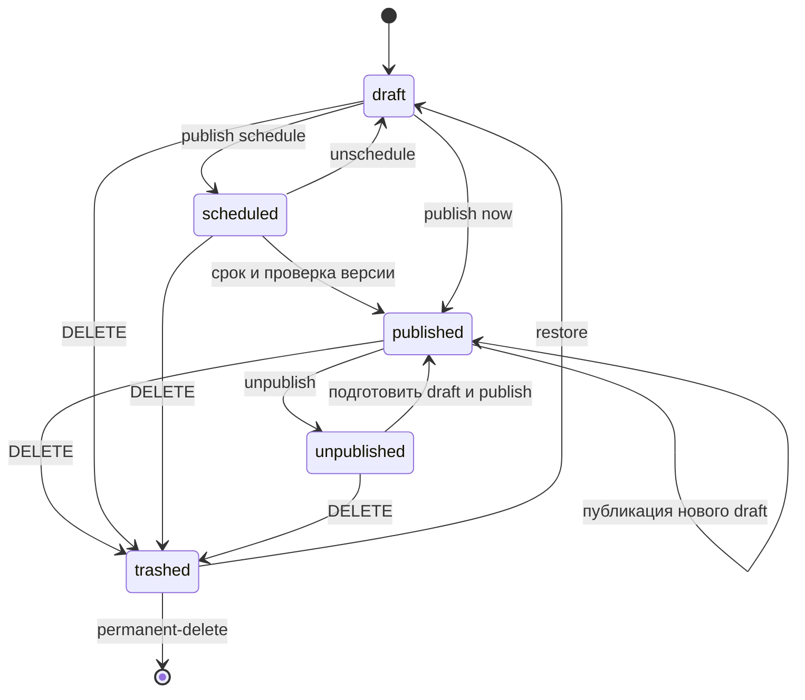

# Новости, обновления и CMS

[Оглавление](../README.md) · [Примеры](EXAMPLES.md) · [Все методы](API_INDEX.md#core)

Источники: [публичные новости](../core/news.yaml), [обновления](../core/updates.yaml), [CMS новостей](../core/cms-news.yaml), [CMS обновлений](../core/cms-updates.yaml), [общие версии и ошибки](../core/shared.yaml). Все методы пока предложены.

## Чтение и доступ

GET `/api/news`, `/api/news/{newsId}`, `/api/updates`, `/api/updates/{updateId}` доступны гостю. Список новостей имеет [multipart-формат](MULTIPART_NEWS.md), остальные ответы JSON. Только опубликованный материал доступен публично. Снятый, черновой, находящийся в корзине или ожидающий расписания возвращает 404, в том числе при обращении к его комментариям и реакциям.

CMS доступна Admin/Owner в `active`, с подтверждённой почтой и пройденной обязательной 2FA. Маршрут `/api/cms/news` содержит список с фильтром `status` и POST создания; для обновлений используется `/api/cms/updates`. Moderator не получает доступ к CMS.

## Редакторский сценарий

1. POST коллекции создаёт неполный черновик, возвращает 201, id и ETag.
2. GET отдельного материала возвращает `draft`, `published`, `status`, `scheduledAt`, `editVersion`, `commentsEnabled`.
3. PUT `/{id}/draft` с If-Match полностью заменяет черновик. Для превью редактор использует этот draft и безопасный Markdown-рендерер; отдельного preview endpoint для новостей/обновлений нет.
4. POST `/{id}/publish` с `{"mode":"now","scheduledAt":null}` публикует готовый черновик. Сервер проверяет содержимое и медиа, сохраняет историю, повышает версию.
5. Правка опубликованного материала снова сохраняется в draft. Посетитель видит прежний published до явного publish. DELETE `/{id}/draft` отбрасывает правки, но для никогда не опубликованной записи даёт 409: её удаляют через корзину.

Новость требует заголовок, краткое описание, Markdown и `coverMediaId` (может быть null). У обновления также есть `version`, `releaseDate` и `sections`. Четыре допустимых раздела: `newFeatures`, `changes`, `fixes`, `balance`. При публикации нужен минимум один непустой раздел; пустые разделы не показываются. Порядок фиксирован. Произвольные новые разделы не допускаются.

## Состояния и расписание

Диаграмма состояния не показывает наличие draft у опубликованного материала: draft существует параллельно published. Снятие с публикации сохраняет данные; если отдельного draft нет, перед повторной публикацией его нужно явно сохранить.

`mode=schedule` предназначен для первой публикации неопубликованной записи. `scheduledAt` обязателен и должен быть в будущем; для `now` он строго null. Чтобы изменить scheduled-черновик, сначала отменяют расписание, иначе 409. Планировщик проверяет статус и версию непосредственно перед commit. Конкурентная корзина/отмена не должна уступать устаревшей задаче.

Backend устанавливает первую `publishedAt`; редактирование её не сбрасывает. Время выпуска игры `releaseDate` независимо. Ровно одна успешная публикация создаёт одну ревизию даже при повторе/гонке планировщика.

## История, корзина и комментарии

GET `/{id}/revisions` выдаёт историю, GET `/{id}/revisions/{revisionId}` реконструирует содержимое, POST этого пути с `/restore` переносит его в новый draft. Автор, исходная дата, обсуждение и реакции не меняются. Чужой revisionId даёт 404. [Сравнение редакций](EXTENDED_GUIDE.md) только читает различия.

DELETE материала перемещает его в корзину. POST `/{id}/restore` восстанавливает **только в draft**, без старого расписания и автоматического публичного доступа. История и обсуждение сохраняются. POST `/{id}/permanent-delete` разрешён только из корзины и требует `{"confirm":true}`; удаляет связанные историю и обсуждение, не уничтожая медиа других ресурсов.

PATCH `/{id}/comments-settings` с `{"enabled":false}` запрещает новые комментарии, но не стирает старые. [Модерация](COMMUNITY.md) действует отдельно от редакторского черновика.

## Ошибки и неопределённость

400/422 обозначают невалидный запрос/содержимое, 409 неподходящее состояние, 412 конфликт версии, 428 отсутствие If-Match. При тайм-ауте публикации сначала перечитайте состояние. У создания черновика нет Idempotency-Key: автоматический повтор может создать вторую запись. Порядок CMS-списка и политика действий автора после снятия материала остаются вопросами согласования; не добавляйте обходные UI-действия.
