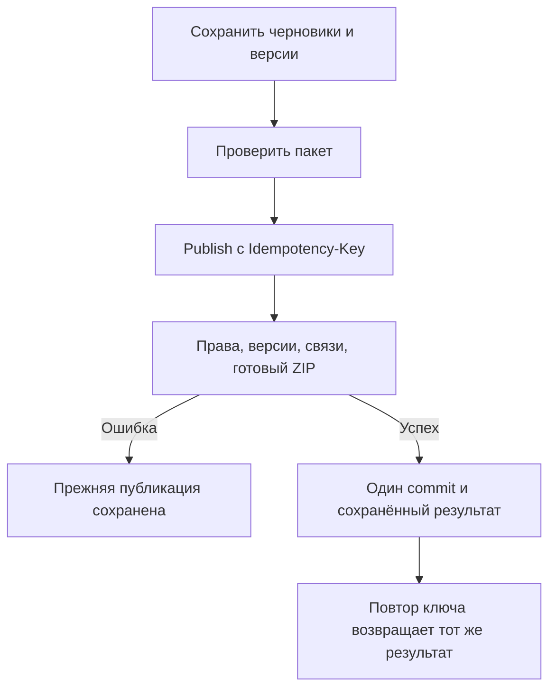

# Расширенные сценарии

[Оглавление](../README.md) · [Примеры](EXAMPLES.md) · [Исходник Extended](../extended.yaml)

13 операций на 12 маршрутах, 18 собственных схем. Статус proposed. Все CMS-методы требуют active Admin/Owner; мутации также CSRF. Extended использует общий Error и редакторские правила Core через исходники.

## Мировая Машина

После активации консоли frontend одним GET `/api/world-machine/texts` загружает опубликованный набор: contentGeneration и items с key/title/bodyMarkdown. Далее зум и переходы не запрашивают текст по одному объекту. Изображения могут загружаться отдельно. Публичный набор имеет ETag; повторный вход может использовать If-None-Match и получить 304 без тела, только если у клиента сохранено соответствующее тело.

GET `/api/cms/world-machine/texts` перечисляет фиксированные ключи и состояния. GET `/{textKey}` возвращает редакторский ETag. PUT `/{textKey}/draft` сохраняет неполный текст; DELETE `/draft` отменяет его; POST `/{textKey}/publish` публикует готовые title и bodyMarkdown. Неполная публикация даёт 422, неизвестный ключ 404, устаревшая версия 412.

GET `/api/cms/world-machine/preview` возвращает собственный WorldMachinePreviewBundle. Для первого неполного черновика отсутствующие поля остаются отсутствующими, пустые строки сохраняются. Для существующей публикации черновик накладывается на публичные поля; это только превью и не доказывает готовность полного replacement-draft к публикации. Превью не кешируется. Схема опубликованных текстов не ослаблена.

CMS не создаёт и не удаляет key, не управляет координатами, связями, пространствами или эффектами. Реестр ключей синхронизируют разработчики. Уникальность key проверяется backend: uniqueItems различает целые объекты, а не значения одного поля. Первое открытие без опубликованных текстов возвращает пустой items.

## Пакетная публикация

Сначала сохранить черновики через Core/World Machine и получить новые editVersion. Затем POST `/api/cms/publication-batches/validate` с items. Типы: worldMachineText, faqItem, faqOrder, presskit, gameSummary. Для одиночных ресурсов ключи строго faq-order, presskit, game-summary. Пара type/resourceKey уникальна, размер пакета 1–100. Новости и обновления в этот пакет не входят.

Validate возвращает canPublish и результаты по каждому элементу. Это снимок проверки, без блокировки ресурсов. POST `/api/cms/publication-batches/publish` повторяет все проверки внутри commit и требует Idempotency-Key. Пакет либо публикуется полностью, либо не публикует ничего, включая ошибки ZIP и FAQ-порядка. Нужный порядок FAQ проверяется относительно итогового набора пакета.

Ключ ограничен инициатором и operationId, связан с каноническим телом. Сначала повторно проверяются права, затем ищется готовый результат. Его возвращают до проверки уже изменившихся версий. Иное тело даёт 409 IDEMPOTENCY_KEY_REUSED, ещё выполняющийся запрос 409 IDEMPOTENCY_IN_PROGRESS. Результат и публикация сохраняются атомарно. TTL ключа пока требует согласования; после его истечения exactly-once не обещается.

Один commit не обеспечивает единый снимок нескольких раздельных GET посетителя, пересекающих момент публикации. Для такого требования нужен отдельный snapshot pinning. Внутри каждого ответа PressKit метаданные и ZIP должны относиться к одному снимку.

## Архив и сравнение редакций

GET `/api/presskit/archive/{snapshotId}` отдаёт неизменяемый опубликованный ZIP с Content-Disposition. GET `/api/cms/presskit/archive/preview-manifest` анализирует черновик и ничего не публикует. Архив подготавливается приватно до SQL commit, затем становится доступным через опубликованную ссылку. Ошибка оставляет прежнее состояние. Политика срока хранения старых архивов открыта; по старому URL нельзя отдать новые байты. Подробнее: [PressKit и медиа](INFORMATION.md).

GET `/api/cms/news/{newsId}/revision-diff` и аналог updates принимают обязательные fromRevisionId/toRevisionId. Обе редакции должны принадлежать материалу, иначе 404. Ответ содержит изменения листовых содержательных полей path/kind/before/after. null обозначает отсутствие поля, пустая строка отличается. Операция не публикует и не восстанавливает; для отката используется Core restore-to-draft. История сохраняет прежний дельта-подход.

Безопасность ZIP, атомарность SQL/файлового хранилища и реальные гонки пока не проверены на backend. Эти требования перечислены в [матрице приёмки](SECURITY.md#матрица-приёмки-backend).
