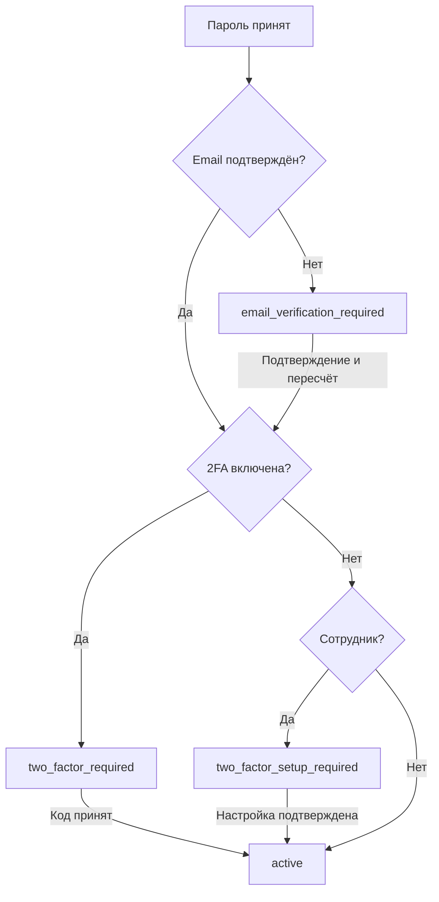

# Зона 1 — фундаментальное API: объяснение и приёмка

[К API-контракту](../README.md)

[Проверяемые HTTP-примеры](EXAMPLES.md) · [Безопасность](SECURITY.md) · [Исходник](../foundation.yaml)

Редакция 0.4 уточняет Cache-Control, CSRF-отказы и восстановление staff. Для
`POST /api/admin/users/{userId}/2fa-recovery` используется `AssistedRecoveryStart`:
`userEmailOwnershipVerified: true` и, для цели Moderator/Admin, обязательный `proof`
текущего второго фактора инициатора Owner. Нельзя заменить его одной активной сессией.
После завершения восстановления старые сессии отозваны, нужен обычный вход.

GET session отвечает 200 для гостя и корректного состояния, но может вернуть
429/500/503 при ограничении или сбое. Все ответы foundation и ошибки имеют no-store.
Setup при уже включённой 2FA даёт 409 и не заменяет фактор. Pending-секрет связан
с текущей сессией; повтор confirm после успеха не раскрывает секреты вновь.

**Статус:** протокол **предлагается** backend-разработчику на согласование. Утверждение пользователем функциональности не равно утверждению имен маршрутов/полей.

## 1. Основной сценарий авторизации

| Этап | Метод | Что получает frontend |
| --- | --- | --- |
| Начало | `GET /api/auth/csrf` | Токен для POST/PATCH/PUT/DELETE; сервер создаёт анонимную cookie при необходимости |
| Проверка | `GET /api/auth/session` | Полное состояние, роль, признаки доступных возможностей |
| Регистрация | `POST /api/auth/register` | Аккаунт создан, письмо отправлено; вход выполняется отдельно |
| Вход | `POST /api/auth/login` | Сессия в одном из четырёх неанонимных состояний |
| Подтверждение почты | `POST /api/auth/email/verify` | Адрес подтверждён, токен использован один раз; нет автоматического обхода 2FA |
| Ввод кода | `POST /api/auth/2fa/challenge` | После успешного TOTP/резервного кода сессия становится `active` |
| Первая настройка 2FA | `POST /api/auth/2fa/setup` + `/confirm` | Секрет TOTP и затем резервные коды, каждый набор только для однократного показа |
| Выход | `POST /api/auth/logout` | Сеанс отозван, ответ 204 |

Состояния `SessionSnapshot.state`:

- `anonymous`: никто не вошёл.
- `email_verification_required`: пароль принят, но email первоначального аккаунта не подтверждён. Разрешены лишь подтверждение, повторная отправка, исправление адреса, выход.
- `two_factor_required`: пароль принят, но обязательный/добровольно включённый фактор ещё не проверен. Привилегии запрещены.
- `two_factor_setup_required`: сотрудник вошёл с паролем, но при назначении роли ещё не имел 2FA; до её настройки служебные действия запрещены. Также используется после аварийного восстановления Owner.
- `active`: доступ к функциям с учётом подтверждённой почты, проверенной 2FA и роли. Название роли из ответа не служит разрешением само по себе.

**Приоритет проверок:** неподтверждённый email → требование ввести 2FA → требование настроить 2FA для staff → active. После каждого завершённого шага сервер пересчитывает состояние, а frontend заново читает сессию. Email-токен и токен сброса пароля не создают полноценную сессию.

## 2. Права (проверять на сервере в каждой операции)

| Операция | Гость | User | Moderator | Admin | Owner |
| --- | :---: | :---: | :---: | :---: | :---: |
| Регистрация, вход, почтовое подтверждение по токену | Да | Да | Да | Да | Да |
| Собственный профиль, аватар, пароль, удаление аккаунта | — | Да | Да | Да | Да* |
| CMS / изменение публикаций | — | — | — | Да | Да |
| Модерация комментариев / запреты комментировать | — | — | Да | Да | Да |
| Обзор списка аккаунтов | — | — | — | Да | Да |
| Назначение/снятие Moderator | — | — | — | Да | Да |
| Назначение/снятие Admin | — | — | — | — | Да |
| Передача Owner | — | — | — | — | Да |
| Сброс 2FA обычного пользователя по обращению | — | — | — | Да | Да |
| Одобрение сброса 2FA Moderator/Admin | — | — | — | — | Да |
| Аварийный сброс собственной 2FA Owner | По трём факторам, независимо от Admin | | | | |

\* Единственный Owner должен **сначала передать владение**, иначе удаление запрещено. Staff с неподтверждённой почтой/непройденной или ненастроенной обязательной 2FA не может выполнять привилегированные действия.

Изменение ролей через `PUT /api/admin/users/{userId}/role`: Admin может назначать/снимать только Moderator у обычных пользователей, Owner может назначать/снимать Admin и Moderator; нельзя изменить Owner. Первоначальное назначение Owner — разовая защищённая операция настройки среды, **не публичный HTTP-метод**.

## 3. Восстановление доступа — три независимых случая

**Забыт пароль.** Пользователь связывается с командой. Admin/Owner убеждается в контроле привязанного подтверждённого email и инициирует `POST /api/admin/users/{userId}/password-recovery`. Пользователь получает ограниченную по времени ссылку и направляет `token` + новый пароль на `POST /api/auth/password-recovery/complete`. Действующий второй фактор **сохраняется**. Нет публичного автоматического сброса пароля без администрации.

**Потеряна обычная 2FA.** Приоритет — запасной одноразовый код. Если он утрачен, Admin может запустить восстановление для User, а Owner — для staff после усиленной проверки; инициирование через `POST /api/admin/users/{userId}/2fa-recovery`, завершение через токен из подтверждённого email. Для staff доступ к служебным функциям блокируется, пока TOTP не настроена заново. Admin никогда не может сбросить 2FA Owner.

**Потеряна 2FA владельца.** `POST /api/auth/owner/emergency-recovery/request` отправляет подтверждение на email Owner. Затем `POST /api/auth/owner/emergency-recovery/complete` одновременно проверяет **email-токен + текущий пароль + отдельный офлайн-ключ**. Сервер погашает ключ и все старые сессии Owner; возвращает `two_factor_setup_required`, создавая только ограниченный сеанс. В ходе `2fa/setup` + `2fa/setup/confirm` владелец получает новые резервные коды **и новый аварийный ключ** для однократного сохранения. Только после этого вновь разрешён доступ Owner. Если утрачен пароль, email или офлайн-ключ, обходного варианта в утверждённых требованиях нет.

## 4. Персональные данные и аккаунт

- Регистрация требует подтверждения email, но вход разрешён в ограниченном состоянии `email_verification_required`.
- Если подтверждённый пользователь меняет email, старый адрес продолжает работать, пока новый не подтверждён. Для ожидающей смены доступны `POST /api/me/email-change/resend` и `DELETE /api/me/email-change` (повтор письма и отмена).
- **Утверждено владельцем (R04):** `username` уникален без учёта регистра ASCII; при сравнении A-Z приводятся к a-z. Текущий шаблон допускает 3–30 латинских букв, цифр и подчёркиваний, запрещая `@`. Конкурирующие регистрации одинакового нормализованного username не создают два аккаунта; конфликт username/email даёт 409. `displayName` остаётся отдельным изменяемым отображаемым именем и не используется для входа.
- `LoginRequest.login` принимает оба варианта: наличие `@` означает поиск только по email, отсутствие только по username без учёта регистра. Переход к другому способу поиска после неудачи запрещён. Поиск email использует те же правила сравнения и уникальности, что регистрация/смена адреса. Пароль, 2FA и ограниченная сессия до подтверждения почты не меняются.
- Удаление аккаунта: `POST /api/me/delete` с `comments = keep_anonymized | erase_text`. Реакции удаляются, собственные комментарии обезличиваются или стираются, чужие ответы сохраняются. Сессии отзываются.
- Нет публичных страниц профиля и ручного изменения/принудительного удаления чужих аккаунтов через административное API.

## 5. Технические гарантии, требующие реализации и тестов

**[Т] Браузерные сессии.** Cookie `HttpOnly`, `Secure`, минимальная область действия, серверная инвалидизация и ротация id после смены привилегий; для `/api/auth/session` и секретных ответов `Cache-Control: no-store`. Имя cookie `zarya_session` **пока предложено**. Сессии с непроверенной 2FA не дают доступ в закрытые интерфейсы.

**[Т] CSRF.** При изменении состояния передаётся `X-CSRF-Token`, полученный через `GET /api/auth/csrf` и связанный с текущей сессией. Проверяются также Origin/Referer с безопасной политикой. После ротации сеанса требуется новый CSRF-токен. Cookie SameSite и CORS не заменяют CSRF-защиту. Учитывать также login-CSRF.

**[Т] Развёртывание.** Предпочтительнее единый HTTPS origin с reverse proxy для трёх приложений и `/api/*`; если приложения используют разные origin, нужны явные CORS-allowlist и `credentials: 'include'` на запросах с cookie. `Access-Control-Allow-Origin: *` с credentials недопустим. `SameSite`/cookie Domain определяются вместе с реальными хостами, **не зафиксированы этим черновиком**.

**[Т] Безопасные токены.** Пароли и одноразовые ключи хранятся в виде устойчивых производных; TOTP-секреты шифруются и управляются отдельно; почтовые и аварийные токены погашаются и не пишутся в access/error logs, telemetry, ссылки API или аналитику. CSRF, login и все recovery endpoints защищены rate limiting. При 429 возвращаются JSON-ошибка и по возможности `Retry-After`. Все проверки времени и авторизации делает сервер.

**[Т] Ошибки.** JSON `{ "code":"...", "message":"...", "errors": { "field": ["..."] }, "requestId":"..." }`. `401` = нет действующей/достаточно подтверждённой сессии; `403` = прав нет, email/2FA не хватает; `409` = конфликт состояния; `410` = одноразовый токен погашен/просрочен; `422` = ошибка полей; `429` = ограничение частоты. Не выдавать существование чужих email в публичных recovery-ответах. JSON и коды окончательно согласовать с backend.

**[Т] Защита персональных данных.** Пользовательские email и чувствительные статусы доступны только своему аккаунту либо ограниченному кругу администрации. Согласовать политику логов, резервных копий, очистки данных и регуляторных требований до запуска. Текущий документ не является юридической экспертизой.

## 6. Приёмочные сценарии зоны 1 (обязательно проверить на реальном backend)

| Тест | Ожидание |
| --- | --- |
| Гость запрашивает `/api/auth/session` | HTTP 200 и `state=anonymous` |
| Вход обычного пользователя с неподтверждённым email | `email_verification_required`; 403 на комментарии, реакции и собственный профиль, но работает повтор письма |
| Вход с 2FA и правильным паролем | `two_factor_required`, CMS/модерация и профиль недоступны до кода |
| Вход сотрудника без настроенной TOTP | `two_factor_setup_required`; служебные функции заблокированы до настройки |
| Передача полномочий Owner | Атомарно: целевой аккаунт получает owner, прежний владелец user независимо от прежних административных полномочий; ровно 1 Owner, прежние привилегированные сессии отозваны; обязательны пароль и totpCode текущего Owner |
| Admin пытается сделать себя Owner или снять Admin | 403; не меняет роли |
| Moderator обращается к CMS | 403 |
| Смена email | До подтверждения нового старый действует |
| Забыт пароль | Письмо инициирует только Admin/Owner, reset не отключает 2FA |
| Owner emergency recovery | Требует все 3 фактора, погашает офлайн-ключ и сеансы, выдаёт новый ключ лишь после новой 2FA |
| Удаление профиля `erase_text` | Старые собственные комментарии не восстанавливаются из модерации, ответы других остаются |
| POST без корректного CSRF | 403 с JSON error, не изменяет состояние |
| CORS недопустимого Origin | Браузер не получает credentialed доступ; сервер не меняет состояние |
| Неверные пароли/коды многократно | Возникает 429/безопасная задержка; утечки существования аккаунта нет |

## 7. Граница зоны 1

Здесь пока **нет** запросов новостей/обновлений, комментариев и их ограничений, CMS, медиа, FAQ, PressKit, Мировой Машины. Однако они **должны** использовать общий формат аутентификации, ошибок, роли и защиту CSRF, принятые для зоны 1. Исключение: известный предварительный `GET /api/news` помещён в `core.yaml` для сохранения существующего frontend/MSW.
