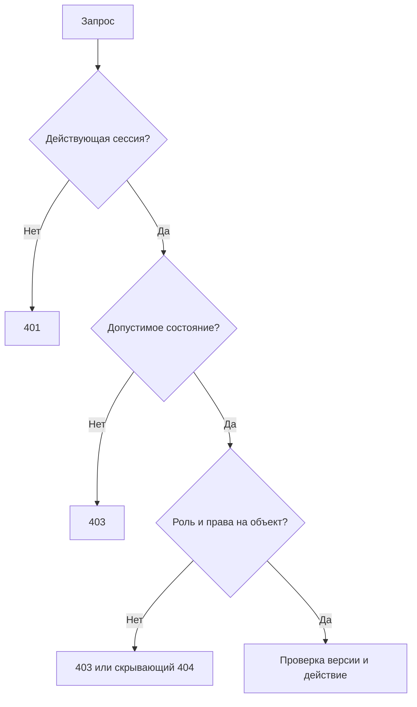

# Безопасность и устойчивость

[Оглавление](../README.md) · [Авторизация](FOUNDATION_GUIDE.md) · [Открытые решения](ZONES_AND_DECISIONS.md)

Это требования предлагаемого контракта и сценарии приёмки. YAML и локальные тесты не доказывают, что сервер уже защищён.

## Сессии, роли и CSRF

Сервер хранит проверяемую сессию. Cookie: HttpOnly, Secure в HTTPS, ограниченные Path/Domain и выбранный SameSite. Предпочтителен единый origin за reverse proxy. Для разных origin нужны явный CORS allowlist и credentials; wildcard недопустим. Итоговые домены, SameSite и TTL ещё не согласованы. На локальном HTTP нельзя выдавать тестирование за проверку production-cookie.

GET `/api/auth/csrf` создаёт анонимный контекст при необходимости. Токен передаётся в `X-CSRF-Token` для всех POST/PUT/PATCH/DELETE, включая login и операции с email-токеном. Проверять связь токена с текущей сессией и разрешённый Origin/Referer. CORS и SameSite не заменяют CSRF. Отказ даёт 403 и не меняет состояние. После login/2FA/смены идентификатора сессии клиент получает свежий CSRF-токен.

Активная cookie не равна разрешению. Для каждого действия проверяются существование аккаунта, актуальная роль, подтверждение email, состояние второго фактора и доступ к конкретному объекту. При отзыве роли старые сессии цели аннулируются атомарно; закешированные claims без проверки версии полномочий недостаточны.

| Возможность | User | Moderator | Admin | Owner |
|---|:---:|:---:|:---:|:---:|
| Собственный профиль/общение при active | Да | Да | Да | Да |
| CMS | Нет | Нет | Да | Да |
| Модерация и баны | Нет | Да | Да | Да |
| Каталог аккаунтов | Нет | Нет | Да | Да |
| Назначить/снять Moderator у User/Moderator | Нет | Нет | Да | Да |
| Назначить/снять Admin | Нет | Нет | Нет | Да |
| Передать Owner | Нет | Нет | Нет | Да |

BOLA/IDOR: проверять автора комментария; родительский публичный материал; принадлежность ответа ветке и материалу; принадлежность revisionId материалу; допустимость mediaId и фиксированного textKey. Непрозрачность id не защищает от перебора.

## Токены и восстановление

Пароли хешируются предназначенным для паролей механизмом; не шифруются обратимо. Email/recovery/аварийные токены одноразовые, с назначением, пользователем, сроком действия и проверяемым производным в хранилище. Токен другого назначения не принимается. TOTP-секрет требует защищённого обратимого хранения с внешним ключом и процедурой ротации. Секреты, коды, password, Cookie и X-CSRF-Token не записываются в логи.

Pending TOTP привязан к пользователю/сеансу и сроку. Setup не заменяет включённый фактор, confirm атомарно погашает pending-секрет. Резервный код погашается один раз даже при двух одновременных запросах. TOTP требует проверки временного окна и защиты от повторного использования шага. Ротация возвращает новый набор один раз; повтор не раскрывает прежний. Потеря ответа решается входом с TOTP и новой явной ротацией.

Восстановление пароля инициирует только администрация после внешней проверки контроля email. Оно не отключает 2FA. При завершении погашаются токен, старые сессии и другие recovery-токены. Для восстановления 2FA staff инициатором может быть только Owner, передающий собственный proof; при погашении снова проверяется текущая роль цели. Восстановление Owner требует email-токен, пароль и офлайн-ключ одновременно. Его нельзя выполнить через admin recovery.

Передача владения оставляет ровно одного Owner, аннулирует старые привилегированные сессии/аварийный ключ прежнего владельца. SQL-ограничение и сериализация должны исключить двух владельцев и нулевого владельца при гонке. По утверждённому решению R04 в одной транзакции целевой аккаунт получает owner, прежний владелец user независимо от прежних административных полномочий. Проверяются пароль и totpCode текущего Owner; передача самому себе даёт 409. Обычный RoleChangeRequest не допускает owner. Это требования контракта, реализация серверной транзакции отдельно не подтверждена.

## Ошибки, лимиты и персональные данные

Ответы с сессией, персональными данными, черновиками, секретами и персональной реакцией запрещено кешировать: `Cache-Control: no-store`, включая ошибки. Cookie не делает CDN-кеш автоматически безопасным. Требуется также исключить эти ответы из ASP.NET output caching и service worker.

429 содержит Retry-After. Ограничивать попытки по аккаунту/сессии и источнику, учитывать параллельные экземпляры API и нейтральные ответы recovery. Конкретные окна/квоты требуют согласования. Постоянная блокировка по одному IP может быть использована для отказа в обслуживании; предпочтительна ограниченная задержка и распределённый бюджет попыток.

Email-существование может раскрываться через 409 регистрации. Точный текст и антиenumeration-политика требуют решения; текущий контракт не обещает абсолютную неразличимость всех операций. Привилегированный bool `userEmailOwnershipVerified` является подтверждением администратора, а не криптографическим доказательством проверки. Нужен внешний регламент и audit trail без секретов.

## Контент, файлы и ZIP

Markdown очищается по allowlist при безопасном рендеринге; raw HTML, javascript/data-URL и опасные атрибуты не исполняются. Комментарии выводятся как текст. Защита нужна в public, CMS-preview и модерации. CSP полезна дополнительно, но не заменяет очистку.

Загрузки проверяются по сигнатуре/декодированию, размеру, пикселям и бюджету памяти. Нельзя доверять расширению, MIME браузера, EXIF или имени. Для ZIP только локальные разрешённые mediaId, безопасные относительные имена, отсутствие symlink/path traversal и коллизий. Внешние ссылки не загружаются сервером, что исключает этот канал SSRF. Подготовленные файлы приватны до успешной публикации.

## Матрица приёмки backend

| Сценарий | Обязательный результат |
|---|---|
| Два редактора с одним ETag | Один commit, второй 412, без потери первой правки |
| Повтор publish после тайм-аута | Старый ETag не создаёт вторую ревизию; GET показывает результат |
| Пакет: один неверный элемент/ZIP упал | Ни один элемент не опубликован |
| Повтор пакета с тем же ключом и телом | Исходный результат; новое тело 409; повторно проверены права |
| Планировщик против unschedule/trash | Проверка версии в транзакции, устаревшая задача не публикует |
| Delete media против публикации | Либо ссылка закреплена, либо публикация отклонена; нет битой ссылки |
| Стирание текста против moderation restore | Стирание необратимо, текст не появляется вновь |
| Роль отозвана при действующей cookie | Следующий служебный запрос отказан |
| Двойное погашение email/recovery/backup-кода | Только один успех |
| Известный comment/revision id чужого материала | Нет доступа через обход родителя |
| Потеря SQL до commit | Нет частичного изменения; 503/безопасный 500 |
| Потеря связи после commit | Результат выясняется повторным чтением/ключом, без ложного обещания отката |
| Одновременная передача Owner/удаление аккаунта | Ровно один Owner сохраняется |
| Повреждённый multipart | Вся страница отвергается, предыдущие карточки сохраняются |

Локальные проверки воспроизводят схемы, правила генерации и клиентские ошибки multipart. Ни одна строка этой таблицы с SQL/транзакциями не считается пройденной без настоящего backend. Нужны интеграционные тесты, тестовая БД, хранилище, почта и отдельные проверки отказов.
